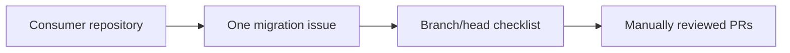

# OrionCore governance templates 🧭

Create **one OrionCore migration or classification issue per detected repository**. Keep all relevant branches and heads in that issue as a checklist; do not open a separate issue for each branch.



## Branch checklist

Use one item per relevant branch or head and include its exact current commit SHA and evidence-based support state:

```text
- [ ] main @ `0123456789abcdef0123456789abcdef01234567` — supported
- [ ] old-prototype @ `89abcdef0123456789abcdef0123456789abcdef` — historical
```

Weak signals remain in the same issue until they are proven as consumers or classified `false-positive`. Update each item with its migration PR and evidence links. OrionCore migration PRs require manual review and must not be auto-merged.
